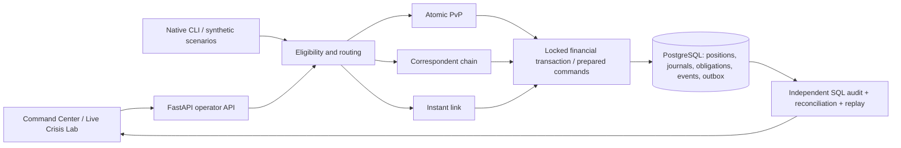
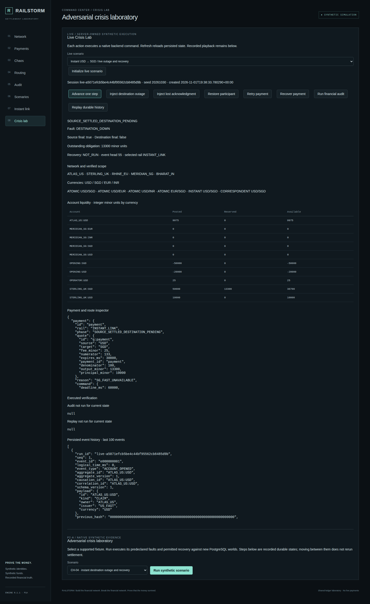
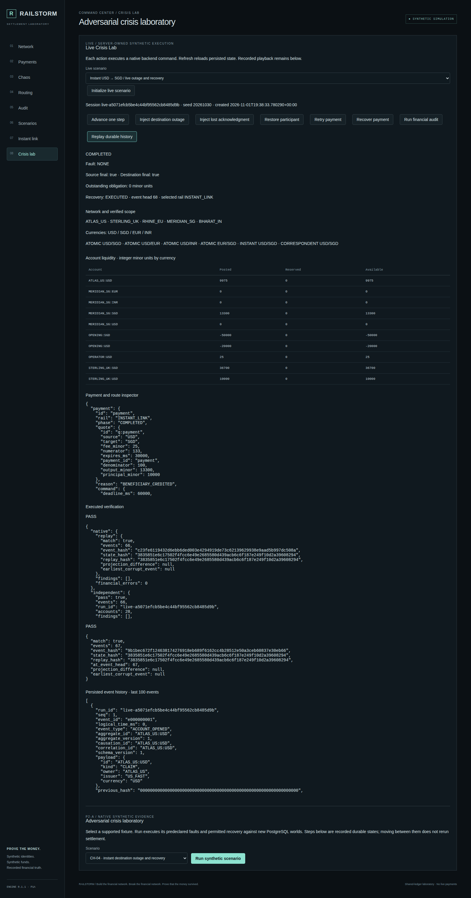

# RAILSTORM
### A Verifiable Multirail Payment Network Simulator

**Synthetic Research Preview · v0.9.0 · All rights reserved**

What happens when one side of a cross-border payment becomes final and the other side fails?
RAILSTORM makes that question executable. It models funded settlement, durable obligations,
versioned FX quotes and recovery across three payment rails, then checks the outcome against
independent accounting and deterministic replay.

This is a local research laboratory. It has no real accounts, live FX feed or real-money connection.
It is not production banking software. Public source visibility does not grant an open-source license.

## Model the money, then break the network

Five synthetic institutions—**Atlas US, Sterling UK, Rhine EU, Meridian SG and Bharat IN**—hold
integer minor-unit accounts in **USD, SGD, EUR and INR**. A currency definition does not imply
that every institution, corridor or rail is funded or executable.

| Native rail | Funded demonstrations | What finality means |
| --- | --- | --- |
| Atomic payment-versus-payment | USD→SGD, USD→EUR, USD→INR, EUR→SGD | Both required currency legs commit together |
| Correspondent banking | Modeled USD→USD and USD→SGD chains | Each funded bank-local hop is independently final |
| Linked instant payments | Atlas USD→Meridian SGD | Source finality can leave a durable destination obligation |

The router filters rail eligibility, funding and corridor constraints before selecting an executable
route. Fixed order is the default. Liquidity/cost/exposure-aware V1/V2 policies are experimental;
the evaluation did not establish a universal optimizer advantage. Dynamic-market instant execution
is available through its native operator; the shared router safely rejects that unadvertised mode.

Payments preserve the accepted quote version and expiry terms. Recovery does not reprice locked
payments or roll back already-final correspondent/source legs. Idempotent retries, reservations,
double-entry journals, decision records, event hashes and transactional outbox entries make those
boundaries inspectable.



## See pending finality and recovery

The **Live Crisis Lab** executes real synthetic operator commands, rather than replaying a picture.
Inject a destination outage, inspect the source-final / destination-pending obligation, refresh to
reload durable state, restore the participant, recover and retry. The beneficiary is credited once.
Lost acknowledgments and correspondent failures are also modeled. Recorded scenario playback is
separately labeled in the interface.

<details>
<summary>Inspect executed pending finality and recovery states</summary>




</details>

These screenshots were captured from genuine R7 container application states during fresh R8
acceptance on an isolated GitHub Actions runner. [Capture provenance](docs/screenshots/PROVENANCE.json)
records their source commit and hashes. See [release verification](docs/RELEASE_VERIFICATION.md).

## Start the local laboratory

Prerequisites: Git, Docker Desktop with Linux containers and Compose. Keep ports bound to loopback.

```sh
git clone https://github.com/Aayush-Kadam/railstorm.git
cd railstorm
docker compose up --build -d --wait
```

Open [Command Center](http://127.0.0.1:8840) and [database-backed health](http://127.0.0.1:8840/api/v1/health).
Startup applies migrations and loads the built-in synthetic scenarios. PostgreSQL stays on the
private Compose network. Named volumes retain ledger and evidence across `docker compose down`;
do not add `--volumes` if you want to retain the experiment.

The lab uses trust authentication inside its private Docker network. The operator API uses a local
ingress boundary, not production authentication. Do not expose this Compose stack to the internet.

### Reproduce a payment, fault and recovery

```sh
docker compose exec -T command-center python -m experiments.r5_smoke initial --checkpoint /app/docs/container-smoke.json
docker compose down
docker compose up -d --no-build --wait
docker compose exec -T command-center python -m experiments.r5_smoke restart --restart-scope stack --checkpoint /app/docs/container-smoke.json
```

The smoke covers all three rails, EUR routing, expiry, insufficient funding, duplicate retry,
quote preservation, a pending obligation across restart, restoration, independent SQL audit and
replay. It is not a throughput benchmark.

For an individual run shown in the interface:

```sh
docker compose exec -T command-center python -m railstorm.cli reconcile YOUR_RUN_ID
docker compose exec -T command-center python -m railstorm.cli replay YOUR_RUN_ID
```

In the browser choose **Crisis lab → Live Crisis Lab → Instant → Initialize**. Advance to prepare,
inject destination outage, advance source and destination, and inspect the **13,300 SGD minor-unit**
pending obligation. Restore, recover, retry, audit and replay. See [setup and demo](docs/SETUP.md)
for native installation, independent audit and development commands.

## Verification and measured performance

| Evidence campaign | Actual result | Scope |
| --- | --- | --- |
| R5 | 261 tests; clean full-stack install; Docker CT-01–CT-10; browser and recreated-stack recovery | Historical R5 source |
| R7 | 268 tests; 12 independent benchmark worlds; 36 concurrency configurations; real database restart across three rails | Historical R7 native/API source |
| R8 / v0.9.0 candidate | 268 tests; clean install; native/browser workflows; Docker payment smoke and recreated-stack recovery PASS | Fresh isolated CI runner; [exact evidence](docs/RELEASE_VERIFICATION.md) |

R7's controlled experiment reduced the matched native atomic-1,000 median from **28.649 to
17.301 seconds (39.61% lower)** with identical financial states and canonical event history.
Its best measured native 1,000-payment run reached **60.32 payments/second**. Independent audit
and replay were measured separately from the historical execution window.

R4's historical native 1,000-payment run took **14.999 seconds**. R4 and R7 were **not** established
as controlled cross-version comparisons. Their timings must not be ranked as equivalent trials.

**The original 10,000-payments-in-60-seconds objective remains UNVERIFIED.** No qualifying
10,000-payment measurement achieved the target; 166.67/s is a target, not a result. No extrapolated
10,000 duration is presented as measured. Establishing it would require additional architectural
work and fresh financial verification. This release ends the optimization campaign.

## Review the boundaries

This is a synthetic research preview, not a distributed production settlement system, live banking
integration or universally optimal router. Same-world command execution is serialized. Broad
platform compatibility and full expanded flagship requirements remain partial. Historical
regeneration tools require their campaign artifacts; they are not the quickstart.

The maintained quality scope is explicit. The Windows historical Python inventory contains **41 type
errors in ten legacy report-generation scripts** (Linux: 52 errors in 12 scripts); see [known limitations](docs/KNOWN_LIMITATIONS.md).
No type-clean claim covers those scripts.

Near-term roadmap: independent reviewer reproduction, broader supported-environment acceptance,
and clearer routing-policy evaluation. New rails and throughput work require separate scoped
evidence campaigns.

## Source and rights

See [release notes](docs/RELEASE_NOTES_v0.9.0.md), [change log](CHANGELOG.md),
[security](SECURITY.md), [contributing](CONTRIBUTING.md), and [publication provenance](docs/PUBLICATION_PROVENANCE.md).
The public snapshot preserves the selected runtime rather than importing private local history,
databases or review ZIP archives. The release designation is v0.9.0; the internal historical engine
compatibility identifier remains 0.1.1.

Copyright 2026. **All rights reserved.** [LICENSE](LICENSE) grants no public software license.
